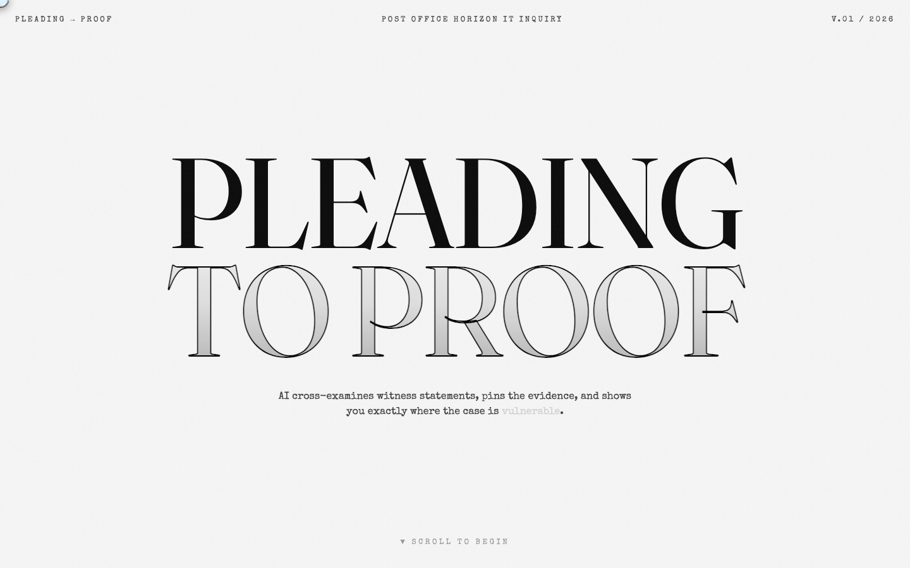
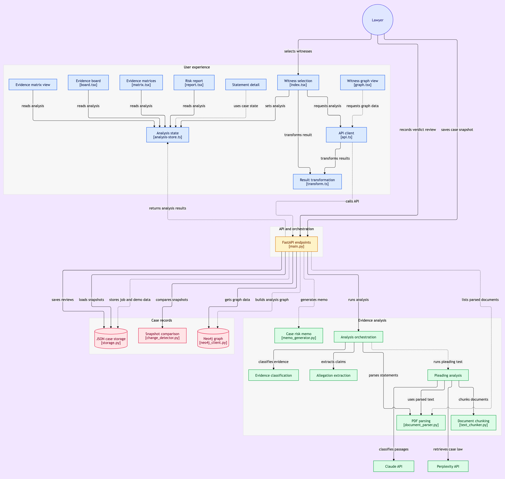

<div align="center">

# Pleading-to-Proof

**An AI stress test for a legal case theory: it reads witness statements, checks each formal allegation against them, and shows where the case is supported, contradicted, or has no evidence. Every quoted passage is verified against its source.**

[](https://cmsxharvey.vercel.app/)


[](https://gitdiagram.com/ishaan-bhalla/cmsxharvey?utm_source=readme&utm_medium=badge)

<a href="https://cmsxharvey.vercel.app/"></a>

<sub>Built at the LLM × Law Hackathon 2026 (CMS × Harvey Challenge), Cambridge Judge Business School, on witness statements from the Post Office Horizon IT Inquiry.</sub>

</div>

## Key results

- **133 witness statements, 8 formal allegations.** Each allegation is checked against the statements and marked SUPPORTED, CONTRADICTED, EVIDENTIAL GAP or UNVERIFIED, with a trial-readiness score.
- **Every cited passage is checked against its source.** A verdict only counts if its quoted passage is found word for word (ignoring spacing and case) in the original statement; otherwise it is downgraded to UNVERIFIED. In the saved demo run, all 13 cited passages passed.
- **Demo run (6 witnesses): 6 of 8 allegations evidenced (score 75%, STRONG), 1 contradiction, 2 evidential gaps,** each with UK case law retrieved alongside.

## Contents

1. [What it does](#1-what-it-does)
2. [Example: a contradiction it surfaced](#2-example-a-contradiction-it-surfaced)
3. [Architecture](#3-architecture)
4. [How the analysis works](#4-how-the-analysis-works)
5. [Limitations](#5-limitations)
6. [Live demo and deployment](#6-live-demo-and-deployment)
7. [Run it locally](#7-run-it-locally)
8. [API](#8-api)
9. [Team](#9-team)

## 1. What it does

Litigators build a case theory, a set of formal allegations, and then need to know which allegations the evidence actually backs. Pleading-to-Proof tests the eight allegations below against the witness statements:

| # | Allegation |
|---|---|
| 1 | The Horizon IT system contained bugs that caused false shortfalls |
| 2 | Post Office knew, or ought to have known, about the defects before prosecutions |
| 3 | Fujitsu could remotely access and alter branch transaction data |
| 4 | Post Office failed to disclose known defects to subpostmasters and their lawyers |
| 5 | Subpostmasters were wrongly prosecuted because of Horizon errors |
| 6 | Senior management knew Horizon was unreliable |
| 7 | Fujitsu's Known Error Log recorded defects not shared with lawyers |
| 8 | Post Office pressured subpostmasters to make good shortfalls |

For each allegation it returns:

- **SUPPORTED:** a witness passage backs the allegation (with a verified quote).
- **CONTRADICTED:** a witness passage cuts against it. This is the highest litigation risk.
- **EVIDENTIAL GAP:** no selected witness addresses it, so more evidence is needed.
- **UNVERIFIED:** the model cited a passage that couldn't be found in the source, so it isn't trusted.

The output is an evidence board, an evidence matrix, a gaps-and-contradictions report, a witness-allegation graph, and a case risk memo.

## 2. Example: a contradiction it surfaced

In the demo run, allegation 1 ("Horizon contained bugs that caused false shortfalls") drew evidence on both sides:

- **Supports (Peter John Rowley, Fujitsu):** *"Bugs, errors and defects are not unusual in large IT systems like Horizon, especially as systems go through the testing and integration cycles."*
- **Contradicts, high confidence (Roderick Mark Ismay, Post Office):** *"Horizon would accurately reflect the incorrect transaction they entered."* The statement attributes discrepancies to users' entries rather than to the system.

That is the kind of tension a lawyer needs to see early, and also the kind of call a lawyer should check. That's why every verdict can be accepted, overruled or rejected in the review step.

## 3. Architecture

[](https://gitdiagram.com/ishaan-bhalla/cmsxharvey?utm_source=readme&utm_medium=picture)

*Architecture diagram (GitDiagram; click to explore it interactively).*

## 4. How the analysis works

- **Background jobs.** An analysis takes minutes, so `POST /analyze/pleading` returns a job ID immediately, and the frontend polls `GET /jobs/{id}` for progress.
- **Retrieval.** Each statement is split into overlapping 3,000-character chunks. The chunks most relevant to an allegation's topic are scored by keyword and sent to the model, so whole statements don't need to fit in one prompt.
- **Classification.** Claude classifies each witness against each allegation and must return the passage it relied on (prompts in `backend/prompts/`).
- **Verification.** The quoted passage is searched for in the statement's full text, ignoring spacing and case. No match means UNVERIFIED, not a verdict.
- **Case law.** Perplexity retrieves relevant UK authorities for each allegation (in the demo, the Bates and Hamilton Post Office judgments), with source links.
- **Human review and audit trail.** Every verdict can be accepted, overruled or rejected, and each decision is timestamped.
- **Snapshots.** The case state can be saved over time, and change detection shows what moved when new evidence arrived.

## 5. Limitations

- **Retrieval can miss evidence.** Chunks are chosen by keyword relevance, so a passage that uses different wording may never reach the model, and the allegation could then show as a false gap.
- **The verdicts are model judgements.** A verified quote proves the passage exists, not that the model read it correctly. The Ismay example above is arguable, which is why review exists.
- **No accuracy benchmark yet.** Verdicts haven't been compared against a lawyer's labels. That would be the next step.
- **Demo scope.** The saved demo uses 6 of the 133 statements.
- **Not legal advice.** It's a triage tool to show a lawyer where to look.

## 6. Live demo and deployment

**[cmsxharvey.vercel.app](https://cmsxharvey.vercel.app/)** loads the pre-computed demo result (6 witnesses, 8 allegations). Running new analyses needs the witness statements and API keys, so it only works locally. The free backend may take up to a minute to wake on the first request.

- **Frontend:** React and Vite, hosted on Vercel.
- **Backend:** FastAPI in Docker, first on Railway and now on Render (`Dockerfile`, `railway.json`).

## 7. Run it locally

Needs Python 3.11+, Node.js 18+ with bun, and API keys for Anthropic, Perplexity and Neo4j Aura (the free tier is enough).

```bash
git clone https://github.com/ishaan-bhalla/CMSxHarvey.git
cd CMSxHarvey
cp backend/.env.example .env        # fill in the five keys
# Put the witness statement PDFs in data/raw/ (the hackathon dataset came from CMS)

python3 -m venv venv && source venv/bin/activate
pip install -r requirements.txt
uvicorn backend.main:app --reload --port 8000     # API docs at http://localhost:8000/docs

curl -X POST http://localhost:8000/demo/precompute   # optional: rebuild the cached demo result

bun install
VITE_API_URL=http://localhost:8000 bun run dev       # frontend at http://localhost:8080
```

Or run the backend in Docker: `docker build -t pleading-to-proof . && docker run -p 8080:8080 --env-file .env pleading-to-proof`.

## 8. API

| Endpoint | Method | Purpose |
|---|---|---|
| `/health` | GET | Server status |
| `/upload` | POST | Upload a witness statement PDF |
| `/documents` | GET | List the witness statements |
| `/analyze` | POST | Witness-against-witness analysis job |
| `/analyze/pleading` | POST | Allegation analysis job; returns a job ID straight away |
| `/jobs/{job_id}` | GET | Job status and progress |
| `/demo` | GET | The pre-computed demo result |
| `/demo/precompute` | POST | Rebuild and cache the demo result |
| `/demo/cache` | DELETE | Clear a stale demo cache |
| `/review` | POST | Accept, overrule or reject a verdict |
| `/reviews/{job_id}` | GET | Review audit trail for a job |
| `/snapshots` | GET, POST | List or save case snapshots |
| `/snapshots/{id}` | GET | One snapshot |
| `/snapshots/compare/{a}/{b}` | GET | What changed between two snapshots |
| `/graph` | GET | Witness-allegation graph data |

## 9. Team

Built in 24 hours by **Ishaan Bhalla** and **[Tanveer Bakshi](https://github.com/TanveerBakshi)**. The frontend repository is [TanveerBakshi/evidence-weaver](https://github.com/TanveerBakshi/evidence-weaver).

- **Ishaan Bhalla:** the backend and AI pipeline (FastAPI service and job queue, Claude classification prompts, citation verification, retrieval and chunking, Neo4j graph, Perplexity case-law search, review audit trail, snapshots, Docker deployment), plus the frontend's API client and data layer that connect it to the UI, and the graph page.
- **Tanveer Bakshi:** the React frontend's design and pages, built with [Lovable](https://lovable.dev) (hence the `lovable-dev[bot]` commits).

Dataset: Post Office Horizon IT Inquiry witness statements, provided by CMS for the hackathon.
